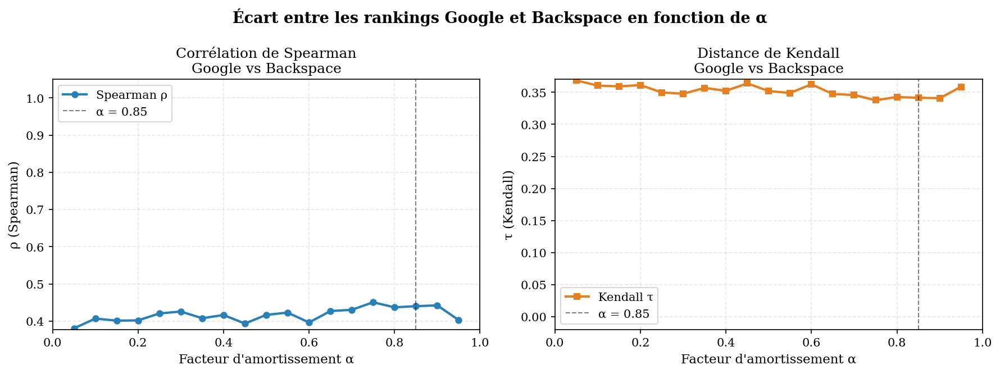
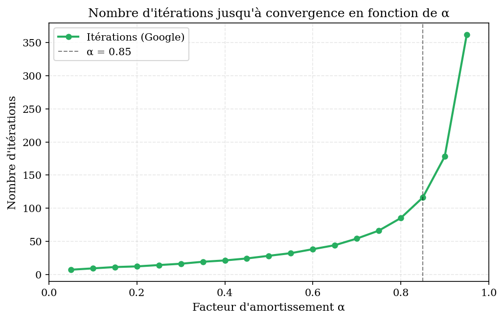
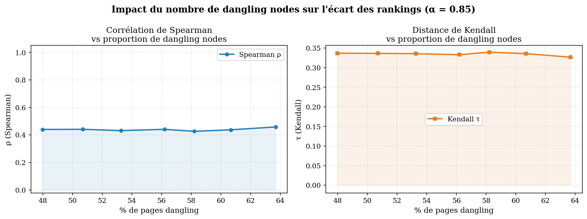
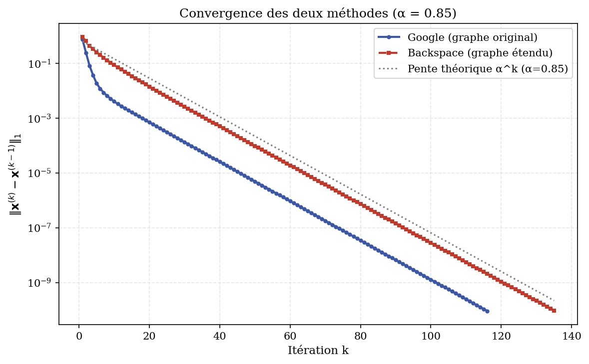
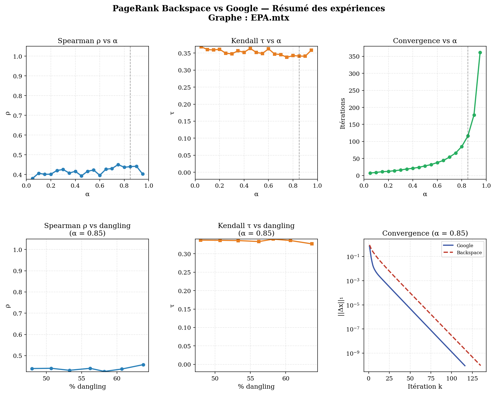
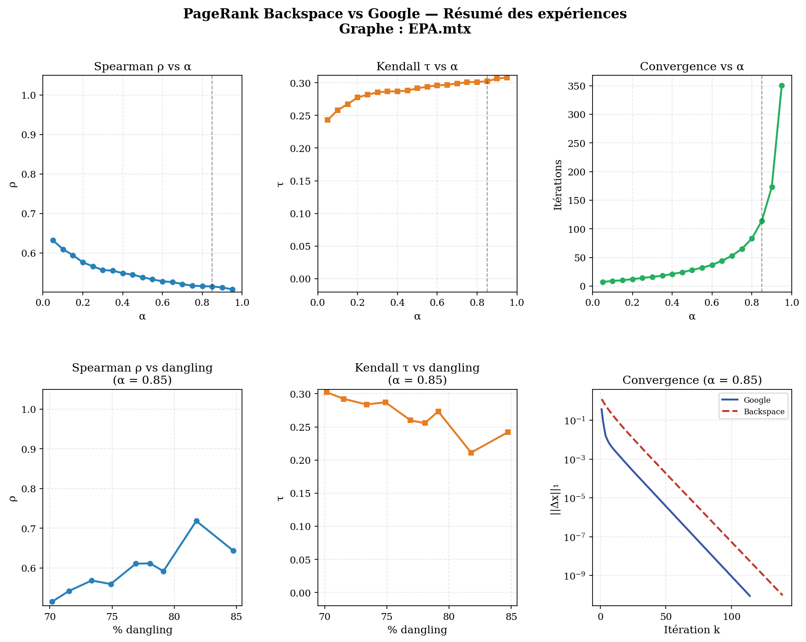
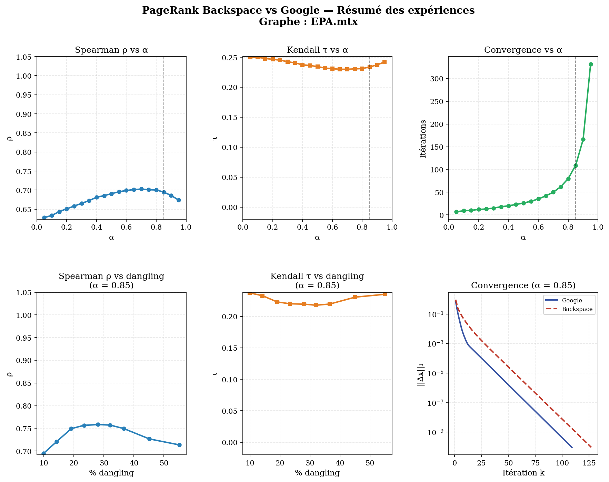

# PageRank : approche Google vs approche Backspace pour les dangling nodes

Implémentation **en C** et comparaison de deux façons de traiter les pages sans lien sortant (*dangling nodes*) dans PageRank :

- **Approche Google** : la masse d'une page sans lien sortant est redistribuée uniformément sur tout le graphe ;
- **Approche Backspace** : l'utilisateur qui arrive sur une page sans issue revient à la page précédente.

Les deux classements sont comparés avec la **corrélation de Spearman ρ** et la **distance de Kendall τ** sur trois graphes réels (web, environnemental, citations scientifiques), en faisant varier le facteur d'amortissement *α* et la proportion de dangling nodes.

> Projet réalisé par **Ouédraogo Abibou**, Master 1, mai 2026 (sujet  : *Le Backspace pour les pages sans lien de sortie*).

---

## Sommaire

- [Le problème](#le-problème)
- [Formalisation](#formalisation)
- [Implémentation](#implémentation)
- [Données](#données)
- [Résultats](#résultats)
- [Conclusions](#conclusions)
- [Limites et points ouverts](#limites-et-points-ouverts)
- [Compilation et exécution](#compilation-et-exécution)

---

## Le problème

PageRank modélise un **surfeur aléatoire** : avec probabilité *α*, il suit un lien sortant de la page courante ; avec probabilité *1 − α*, il se téléporte vers une page quelconque. Le score d'une page est la distribution stationnaire de cette chaîne de Markov.

Un **dangling node** est une page de degré sortant nul : le surfeur y est piégé. On distingue :

- les pages **avec prédécesseurs** ($d^-(P) > 0$), cas traité par ce projet ;
- les pages **totalement isolées** ($d^-(P) = 0$) : personne ne peut y arriver en naviguant, donc la question du retour arrière ne se pose pas. Les deux approches les traitent de la même façon, par téléportation.

## Formalisation

**Itération de PageRank (approche Google)**, avec *H* la matrice stochastique par colonnes, *D* l'ensemble des dangling nodes et *z* le vecteur de téléportation uniforme ($z_i = 1/N$) :

$$x^{(k+1)} = \alpha \left( H x^{(k)} + \sum_{i \in D} x_i^{(k)} \, z \right) + (1 - \alpha)\, z$$

**Construction du graphe Backspace.** Chaque dangling node *P* est dupliqué en autant de **clones** qu'il a de prédécesseurs, pour conserver l'information « d'où l'on vient » :

1. les pages normales ($d^+ > 0$) sont transférées dans le graphe étendu ;
2. pour chaque prédécesseur $X_k$ de *P* : création du clone $(P, X_k)$, remplacement de l'arc $X_k \to P$ par $X_k \to (P, X_k)$, ajout de l'arc retour $(P, X_k) \to X_k$ ;
3. recopie des arcs entre pages normales ;
4. recalcul des degrés et des listes de voisins entrants.

Le graphe étendu compte $N_{trans} = |\{i : d^+(i) > 0\}| + \sum_{P \in D} d^-(P)$ nœuds et **ne contient plus aucun dangling node**.

**Agrégation.** Après convergence, le score de chaque page d'origine est la somme de son score et de ceux de ses clones, puis le vecteur est renormalisé en norme L1.

**Métriques de comparaison :**

- **Spearman ρ** ∈ [−1, 1] : ρ = 1 pour des classements identiques. Sensible aux grands écarts de rang.
- **Kendall τ** ∈ [0, 1] (proportion de paires discordantes) : τ = 0 pour des classements identiques. Compte directement les inversions de paires.

## Implémentation

Tout le code de calcul est dans `Backspace.c`, organisé en plusieurs blocs ci-dessous. Les graphiques sont produits à partir des CSV par le script Python `plot_results.py`.

| Fonction | Rôle |
|---|---|
| `lire_graphe` | lecture des formats Matrix Market (`.mtx`, base 1) et texte (base 0) |
| `sauvegarder_graphe` / `restaurer_graphe` | garantissent que chaque expérience repart du graphe original |
| `detruire_liens_sortants` | transforme une fraction aléatoire de pages normales en dangling nodes |
| `transformer_backspace` | construit le graphe étendu (4 étapes) |
| `pagerank_sur` | itération de puissance générique, utilisée pour les deux approches ; enregistre la courbe de convergence |
| `agreger_scores_backspace` | ramène les scores des clones vers les pages d'origine |
| `calculer_spearman`, `calculer_kendall` | métriques, via `calculer_rangs` |
| exports CSV | `resultats_alpha.csv`, `resultats_taux.csv`, `convergence_google_085.csv`, `convergence_backspace_085.csv` |

**Choix de robustesse et d'optimisation :**

- `correspondance[]` est initialisé à −1 : si un prédécesseur est lui-même dangling, l'accès invalide est détecté et le lien ignoré avec un avertissement, sans crash ni comportement indéfini.
- La taille est vérifiée avant chaque écriture dans les listes de voisins (`MAX_VOISINS`), ce qui protège contre les corruptions mémoire silencieuses sur les graphes avec des hubs très connectés.
- Les tris à bulles en O(N²) de la première version ont été factorisés dans `calculer_rangs()` avec `qsort` en **O(N log N)**, soit un facteur d'accélération théorique d'environ 730 pour N = 9 664.

## Données

Trois graphes issus de la [SuiteSparse Matrix Collection](https://sparse.tamu.edu/) et de [SNAP](https://snap.stanford.edu/data/). Les fichiers sont inclus dans le dépôt, avec un petit graphe de test (`graph.txt`).

| Graphe | Nature | Pages (N) | Arcs | Dangling nodes | $N_{trans}$ |
|---|---|---|---|---|---|
| California | web (recherche « California ») | 9 664 | 16 150 | 4 637 (48 %) | 13 103 |
| EPA | web environnemental | 4 772 | 8 965 | 3 350 (70 %) | 7 671 |
| HEP-th | citations scientifiques | 27 770 | 352 807 | 2 750 (10 %) | 49 426 |

Ces graphes couvrent une large gamme : de 10 % à 70 % de dangling nodes, et des densités très différentes (HEP-th est environ 13 fois plus dense que California).

## Résultats

### 1. Variation de α (graphe California)

19 valeurs testées, *α* ∈ {0.05, 0.10, …, 0.95}.



| α | ρ (Spearman) | τ (Kendall) | Itérations |
|---|---|---|---|
| 0.05 | 0.380 | 0.369 | 7 |
| 0.25 | 0.421 | 0.350 | 14 |
| 0.50 | 0.417 | 0.352 | 28 |
| 0.75 | 0.451 | 0.338 | 66 |
| **0.85** | **0.440** | **0.341** | **116** |
| 0.95 | 0.403 | 0.359 | 362 |

- ρ oscille entre 0.38 et 0.45 et τ reste autour de 0.34, **sans tendance monotone** : sur ce graphe, l'écart entre les deux classements est important mais presque indépendant de *α*.
- Le nombre d'itérations explose quand *α* → 1 (7 itérations à 0.05, 362 à 0.95).

  

- **Pages affectées** : l'approche Backspace favorise les **prédécesseurs des dangling nodes**, dont la masse revient intégralement par le retour arrière au lieu d'être dispersée. Certaines pages globalement populaires (pages 1487 et 4390) perdent légèrement du rang.

### 2. Impact du nombre de dangling nodes (California, α = 0.85)

Le graphe est restauré avant chaque taux, puis une fraction des pages normales perd tous ses liens sortants. Dans cette partie, la distance de Kendall est estimée par Monte-Carlo sur 100 000 paires tirées au hasard (`calculer_kendall_approx`), alors que la partie 1 utilise le calcul exact.



| Taux de destruction | Pages sans sortie | ρ | τ (estimé) |
|---|---|---|---|
| 0 % | 4 637 (48.0 %) | 0.440 | 0.340 |
| 10 % | 5 159 (53.4 %) | 0.439 | 0.334 |
| 20 % | 5 659 (58.5 %) | 0.445 | 0.333 |
| 30 % | 6 114 (63.3 %) | 0.470 | 0.320 |
| 40 % | 6 628 (68.6 %) | 0.459 | 0.322 |

**Résultat paradoxal** : plus on crée de dangling nodes, plus les classements se rapprochent (τ passe de 0.340 à 0.322). Explication : les pages devenues isolées obtiennent des scores quasi nuls dans les deux méthodes et se retrouvent classées de la même façon en bas du classement, ce qui masque les vraies divergences. Les oscillations de ρ viennent du caractère aléatoire de la destruction (graine non fixée).

### 3. Convergence (α = 0.85)



Les deux méthodes ont une convergence **géométrique** (droites en échelle semi-logarithmique) au taux théorique *α*. La méthode Backspace travaille sur un graphe plus grand mais converge au même taux.

Sur les trois graphes, le nombre d'itérations est quasiment identique à *α* fixé : **109 à 116 itérations pour α = 0.85**, **332 à 362 pour α = 0.95**, quelles que soient la taille et la densité. Le taux de convergence dépend de *α* et non de la structure du graphe.

### 4. Comparaison des trois graphes

Chaque tableau de bord résume, pour un graphe, ρ et τ en fonction de α et du taux de destruction, ainsi que la convergence.

<details open>
<summary><b>California</b> (48 % de dangling nodes)</summary>


</details>

<details>
<summary><b>EPA</b> (70 % de dangling nodes)</summary>


</details>

<details>
<summary><b>HEP-th</b> (10 % de dangling nodes)</summary>


</details>

Les figures détaillées de chaque graphe sont dans les dossiers [`figures_california/`](figures_california), [`figures_EPA/`](figures_EPA) et [`figures_HEP/`](figures_HEP).

| Graphe | Dangling | ρ (α = 0.85) | τ (α = 0.85) | Évolution avec α |
|---|---|---|---|---|
| HEP-th | 10 % | 0.695 | 0.238 | ρ monte de 0.63 à 0.70 puis redescend légèrement |
| California | 48 % | 0.440 | 0.341 | stable, pas de tendance nette |
| EPA | 70 % | 0.515 | 0.303 | ρ décroît de 0.63 à 0.51, τ croît de 0.24 à 0.31 |

- La **proportion de dangling nodes** détermine à la fois l'ampleur de l'écart entre les méthodes et la visibilité de son évolution avec *α*.
- EPA, avec le plus de dangling nodes, est le seul graphe où la tendance théorique (*α* → 1 ⇒ plus de divergence) apparaît clairement.
- **Destruction de liens** : le paradoxe (classements qui se rapprochent) se retrouve sur les trois graphes. Sur HEP-th, ρ monte de 0.695 à 0.758 jusqu'à 25 % de destruction puis redescend au-delà de 30 % : le graphe bascule alors dans un régime proche de celui de California et EPA.

### 5. Complexité

| Méthode | Taille | Coût par itération | Nombre d'itérations |
|---|---|---|---|
| Google | N | O(nnz(H)) | O(log ε / log α) |
| Backspace | $N_{trans} \geq N$ | O(nnz($H_{ext}$)) | identique |

Le surcoût de Backspace est proportionnel au nombre de clones créés ($\sum_{P \in D} d^-(P)$ nœuds et arcs supplémentaires). Il peut être important avec beaucoup de dangling nodes très connectés, mais reste linéaire en la taille du graphe.

## Conclusions

1. Les approches Google et Backspace produisent des **classements nettement différents**, avec un écart qui dépend fortement de la proportion de dangling nodes : ρ ≈ 0.44 sur California, 0.52 sur EPA, 0.70 sur HEP-th (α = 0.85).
2. L'effet de *α* dépend du graphe : monotone sur EPA (70 % de dangling nodes), stable sur California (48 %), inversé sur HEP-th (10 %), où les deux méthodes restent proches.
3. La **vitesse de convergence dépend uniquement de α**, ce que confirment les trois jeux de données.
4. L'approche Backspace **favorise les prédécesseurs directs** des dangling nodes, ce qui correspond mieux au comportement réel de navigation pour les pages sans issue (pages d'erreur, PDF sans hyperliens). La matrice reste stochastique, et la convergence est garantie par le théorème de Perron-Frobenius.
5. La destruction de liens rapproche paradoxalement les classements, phénomène structurel reproduit sur les trois graphes.
6. Le cas d'un prédécesseur lui-même dangling est détecté et traité sans crash.

## Limites et points ouverts

- **Coût de calcul à fort taux de destruction.** Sur la première machine utilisée, le calcul ne terminait plus au-delà de 40 % de destruction (California, EPA), c'est pourquoi les tableaux s'arrêtent à 40 %. Sur une machine plus puissante, le taux de 50 % a pu être calculé. Le coût vient de l'explosion du nombre de clones dans le graphe étendu et du ralentissement de la convergence quand la proportion de dangling nodes dépasse 70 %. **Piste** : remplacer les tableaux statiques (`MAX_NOEUDS`, `MAX_VOISINS`) par une allocation dynamique.
- **Graine aléatoire non fixée** (`srand(time(NULL))`) pour la destruction de liens : les résultats de la partie 2 ne sont pas exactement reproductibles et présentent des oscillations. Fixer la graine et moyenner sur plusieurs tirages rendrait les tendances plus fiables.
- **Comportement pour α petit** : en théorie, les deux classements devraient se rapprocher quand *α* → 0 (la téléportation uniforme domine). Sur California, ρ reste pourtant à 0.38 pour *α* = 0.05. Une piste à vérifier est l'effet des ex aequo (nombreuses pages de scores très proches ou égaux) sur le calcul des rangs.
- Le modèle Backspace suppose que l'utilisateur revient **exactement** à la page précédente, ce qui reste une hypothèse comportementale.

## Compilation et exécution

### Structure du dépôt

```
pagerank-backspace/
├── Backspace.c          # lecture des graphes, PageRank Google et Backspace, métriques, export CSV
├── plot_results.py      # tracé des graphiques à partir des CSV
├── California.mtx       # graphe web, 9 664 pages
├── EPA.mtx              # graphe web environnemental, 4 772 pages
├── HEP-th.mtx           # graphe de citations, 27 770 pages
├── graph.txt            # petit graphe de test (mode verbeux)
├── figures_california/  # figures du graphe California
├── figures_EPA/         # figures du graphe EPA
├── figures_HEP/         # figures du graphe HEP-th
├── Rapport.pdf          # rapport complet
└── README.md
```

Chaque dossier de figures contient les mêmes cinq graphiques :

| Fichier | Contenu |
|---|---|
| `spearman_kendall_alpha.png` | ρ et τ en fonction de α |
| `iterations_alpha.png` | nombre d'itérations en fonction de α |
| `metriques_taux.png` | ρ et τ en fonction du taux de destruction |
| `convergence_085.png` | convergence des deux méthodes à α = 0.85 |
| `dashboard.png` | résumé en six panneaux des graphiques précédents |

### 1. Compiler

```bash
gcc -O2 -o backspace Backspace.c -lm
```

Sous Windows, la compilation produit `backspace.exe`, qui se lance avec `.\backspace.exe`.

### 2. Lancer les expériences

Le programme a deux modes :

| Commande | Graphe | Sortie |
|---|---|---|
| `./backspace` | graphe choisi dans le code | mode résumé : top 10 des classements, 20 plus grands changements de rang, métriques |
| `./backspace -v` | `graph.txt` | mode verbeux : voisins, degrés, classements complets et scores agrégés, pour vérifier le fonctionnement sur un petit exemple |

En mode résumé, le graphe étudié est fixé dans la fonction `main` de `Backspace.c`. Pour changer de graphe, modifiez cette ligne puis recompilez :

```c
const char *fichier = verbeux ? "graph.txt" : "EPA.mtx";   // ou "California.mtx", "HEP-th.mtx"
```

Chaque exécution enchaîne les deux parties de l'étude :

1. **Variation de α** de 0.05 à 0.95 sur le graphe original ;
2. **Destruction de liens** à α = 0.85, pour des taux de 0 % à 50 %.

Elle produit quatre fichiers CSV :

| Fichier | Contenu |
|---|---|
| `resultats_alpha.csv` | `alpha, spearman, kendall, iter_google` |
| `resultats_taux.csv` | `taux_demande, pct_dangling, spearman, kendall, n_trans` |
| `convergence_google_085.csv` | écart ‖x⁽ᵏ⁾ − x⁽ᵏ⁻¹⁾‖₁ à chaque itération, approche Google, α = 0.85 |
| `convergence_backspace_085.csv` | idem, approche Backspace |

### 3. Tracer les graphiques

```bash
pip install matplotlib pandas
python plot_results.py
```

Les noms des CSV sont fixes : chaque exécution de backspace écrase les résultats de la précédente, et plot_results.py trace donc les courbes du dernier graphe étudié. Les figures fournies dans figures_california/, figures_EPA/ et figures_HEP/ ont été produites graphe par graphe de cette façon.

Le rapport complet est disponible dans [`Rapport.pdf`](Rapport.pdf).

## Références

- V. Batagelj, A. Mrvar, *Pajek/California*, UF Sparse Matrix Collection, 2006.
- T. Davis, *Pajek/EPA*, UF Sparse Matrix Collection, 2006.
- J. Leskovec, J. Kleinberg, C. Faloutsos, *Graph Evolution*, graphe HEP-th, Stanford SNAP.
